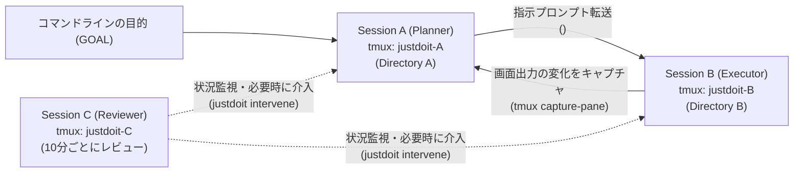

# justdoit

`tmux` 上で 3 つのセッション（計画役 Session A・実行役 Session B・定期レビュー役 Session C）を起動し、`tmux capture-pane` / `paste-buffer` のみを用いて自律的に計画・実行・相互フィードバック・定期監査を行うターミナルオーケストレーターです。

## アーキテクチャ



1. **Session A (`justdoit-A` / 計画・指示役)**
   - Session B とは異なる独立ディレクトリ（デフォルト: `~/.justdoit/runs/<slug>/session_a`）で `claude --dangerously-skip-permissions`（または `$CLAUDE_BIN`）を起動します。
   - 与えられた目的（GOAL）に対して `PLAN.md` を作成・更新し、Session B に実行させる具体的な指示プロンプト（`<NEXT_PROMPT>...</NEXT_PROMPT>`）を出力します。
2. **Session B (`justdoit-B` / 実行役)**
   - ターゲットの作業ディレクトリ（デフォルト: カレントディレクトリ）で `claude --dangerously-skip-permissions`（または `$CLAUDE_BIN`）を起動します。
   - Session A から転送された指示を実行し、`tmux capture-pane` の出力内容に変化がありターンが完了すると、その出力が Session A に流し込まれます。
3. **Session C (`justdoit-C` / 定期レビュー・介入役)**
   - 独立ディレクトリ（デフォルト: `~/.justdoit/runs/<slug>/session_c`）で `agy --dangerously-skip-permissions`（または `$AGY_BIN`）を起動します。
   - デフォルト **10分ごと**（`--review-interval 600`）に Session A と Session B の画面スナップショットと計画の進捗をレビューし、ループやスタック等で介入が必要と判断した場合は Session A または Session B に介入指示を送ります。
4. **4分割ダッシュボード (`justdoit-view`)**
   - Session A・Session B・Session C・オーケストレーターログを1つの画面でリアルタイムに一覧監視できる `tmux` セッションです。

## インストール

```bash
chmod +x justdoit
ln -sf "$(pwd)/justdoit" ~/.local/bin/justdoit
```

## 使い方

```bash
# カレントディレクトリを Session B の作業ディレクトリとして開始
justdoit "Webペイントアプリを作成してテストを通す"

# ローカルLLMラッパー (claude-local 等) や別ディレクトリを指定して起動
CLAUDE_BIN=claude-local justdoit --dir-a /tmp/planner --dir-b ./workspace "目的..."

# 4画面統合ダッシュボード（または個別セッション a / b / c）にアタッチ
justdoit attach          # 4分割ダッシュボード (justdoit-view)
justdoit attach a        # Session A (Planner)
justdoit attach b        # Session B (Executor)
justdoit attach c        # Session C (Reviewer)

# 現在のステータスと各セッションの画面末尾を表示
justdoit status

# 10分待たずに今すぐ Session C によるレビューを実行
justdoit review-now

# Session A または Session B に手動/外部から介入指示を送る（ハング時は --interrupt）
justdoit intervene --target B --interrupt "テストがハングしているため別アプローチに切り替えてください"

# 全セッションとオーケストレーターを停止
justdoit stop
```

## オプション・環境変数

| オプション / 環境変数 | デフォルト | 説明 |
|---|---|---|
| `--dir-a` | `~/.justdoit/runs/<slug>/session_a` | Session A (Planner) の作業ディレクトリ |
| `--dir-b` | カレントディレクトリ (`pwd`) | Session B (Executor) の作業ディレクトリ |
| `--dir-c` | `~/.justdoit/runs/<slug>/session_c` | Session C (Reviewer) の作業ディレクトリ |
| `--review-interval` | `600` (10分) | Session C による定期レビューの間隔（秒） |
| `--claude-bin` / `CLAUDE_BIN` | `claude` | Session A / B で起動するコマンド（`claude-local` 等に変更可） |
| `--agy-bin` / `AGY_BIN` | `agy` | Session C で起動するコマンド |
| `--session-prefix` | `justdoit` | 作成する `tmux` セッション名のプレフィックス |
| `--stop-on-complete` | `False` | Session A が `<GOAL_ACHIEVED>` を出力した時点で自動終了する |

## 利用規約・運用上の注意 (Disclaimer)

- 本ツールは `tmux` の標準機能（`new-session`, `capture-pane`, `paste-buffer`, `send-keys`）のみを用いてターミナル入出力を仲介する汎用スクリプトであり、各 CLI ツールの内部ファイルや非公開 API・認証トークンには一切アクセスしません。
- 各 AI コーディング CLI を自動ループで長時間稼働させる場合は、各プロバイダの利用規約（Terms of Service）に従い、**従量課金 API キー（`ANTHROPIC_API_KEY` 等 / Commercial Terms）またはローカル LLM 環境（`claude-local` 等）** でご利用ください。

## ライセンス

MIT License
